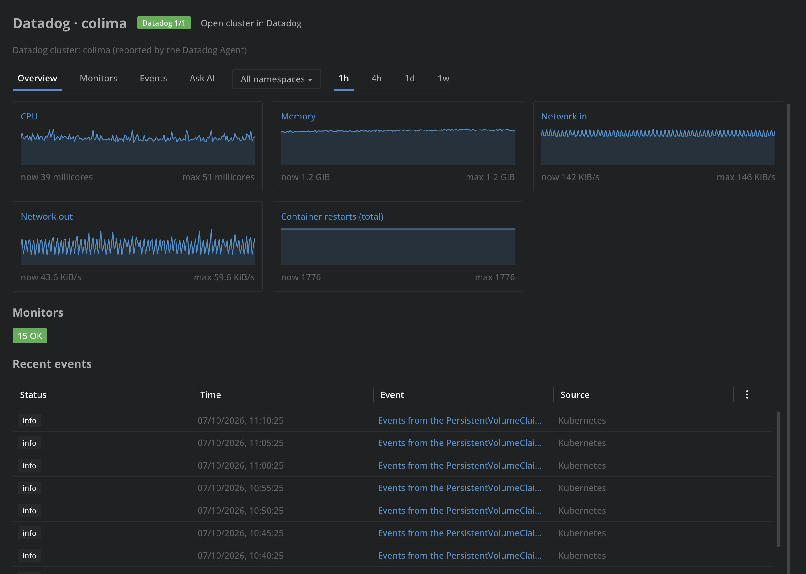
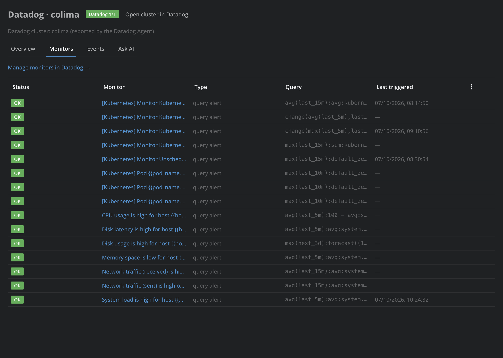
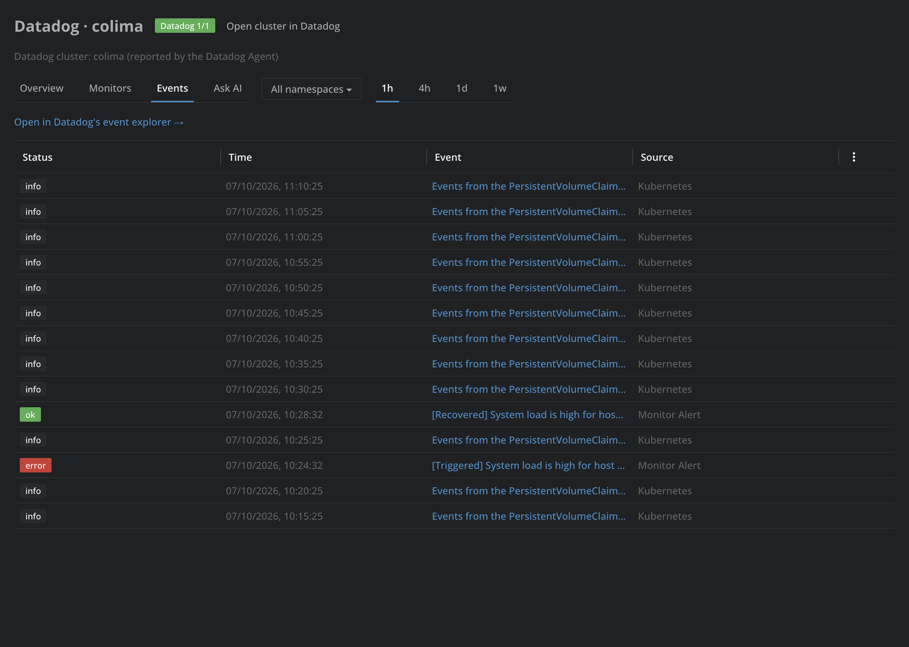

# Datadog for Lens

See what Datadog knows about your Kubernetes resources without leaving Lens: CPU, memory, network and restart charts, monitors and events, for a resource, a namespace or a whole cluster. Every chart, monitor and event links to the same view on the Datadog website, and any resource opens in Datadog's logs, APM traces, metrics, Kubernetes Explorer or events, already filtered to it. The status bar shows whether the current cluster runs the Datadog Agent.

This is a community extension. It is not made or endorsed by Datadog.

## Features

- **Open in Datadog** in the menu of a resource (right-click a row, or its ⋮ button), for pods, deployments, stateful sets, daemon sets, replica sets, jobs, cron jobs, services, namespaces and nodes: Logs, APM traces, Metrics, Kubernetes Explorer and Events open in your browser.
- **A Datadog section in the details panel** of the same resources: the same links, the cluster's name in Datadog, the monitors grouped by the resource (worst status first), CPU and memory charts over 1 hour to 1 week, and the latest events. Click a chart, monitor or event to open it in Datadog.
- **A Datadog view of each cluster**, from the **Datadog** item under the cluster in the navigator, the status bar badge, or the command palette:
  - **Overview**: CPU, memory, network in and out and container restart charts for the cluster or one namespace, a count of monitors by status, and recent events.
  - **Monitors**: every monitor of your Datadog account, with its status, query and when it last triggered.
  - **Events**: the cluster's or namespace's Datadog events, newest first.
  - **Ask AI**: a conversation that answers from Datadog's data, such as "why did coredns use more CPU this morning?".
- **Datadog Agent status** in the status bar for the cluster you are looking at, such as `Datadog 5/5` when five of five Agent pods are ready. Hover it for each Agent and Cluster Agent workload and its version, and click it to open the cluster's Datadog view.
- **Command palette**: *Datadog: Open Datadog view of cluster*, *Datadog: Open cluster in Datadog* and *Datadog: Open preferences*.

The Monitors tab lists every monitor of your Datadog account, and the Events tab the cluster's events, each row linking to Datadog:

## Install

[Open Datadog for Lens in Lens](https://app.k8slens.dev/lens-launcher?c=lens%3A%2F%2Fapp%2Fopen%2Fextension%3Fname%3D%2540k8slens%252Fdatadog) and click Install there. The link offers Lens for download when it is not installed yet.

## Usage

Open **Preferences > Extensions > datadog**:

- **Datadog site**: the site your organization uses, such as US1 (`datadoghq.com`) or EU1 (`datadoghq.eu`).
- **API access** (optional): an API key and an application key. The charts, monitors and events need them; links work without. Give the application key the scopes of what you want to see: `timeseries_query` for charts, `monitors_read` for monitors and `events_read` for events. A view whose scope is missing says so. Click **Test connection** to check them. The keys are stored in Lens's data directory on your machine. Requests go to Datadog through `curl`, which must be on your PATH (it ships with macOS and most Linux distributions).
- **Cluster names in Datadog**: the `kube_cluster_name` each cluster has in Datadog. Leave a cluster's name empty and the extension reads `DD_CLUSTER_NAME` from the Datadog Agent in that cluster. Without either, links search all clusters.

The extension finds the Datadog Agent by the images of the cluster's daemon sets and deployments (`datadog/agent`, `datadog/cluster-agent`), so you need permission to list them.

## Ask AI

From any Ask AI conversation you can also:

- ask for the Datadog links of a resource, such as "give me the Datadog logs link for the checkout deployment";
- have it open a resource's logs, traces, metrics, Kubernetes Explorer entry or events in Datadog;
- ask whether a cluster runs the Datadog Agent, how many of its pods are ready, and which version it is;
- ask about a resource's, namespace's or cluster's CPU, memory, network or restarts over the last hour to week, from Datadog's metrics;
- ask which Datadog monitors watch something and whether they are alerting;
- ask what happened to something recently, from Datadog's events.

In a cluster's Datadog view, the Ask AI tab is a conversation about that cluster's Datadog data.

What changed in each version is in [CHANGELOG.md](./CHANGELOG.md).
